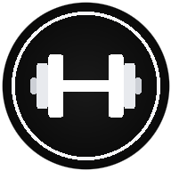
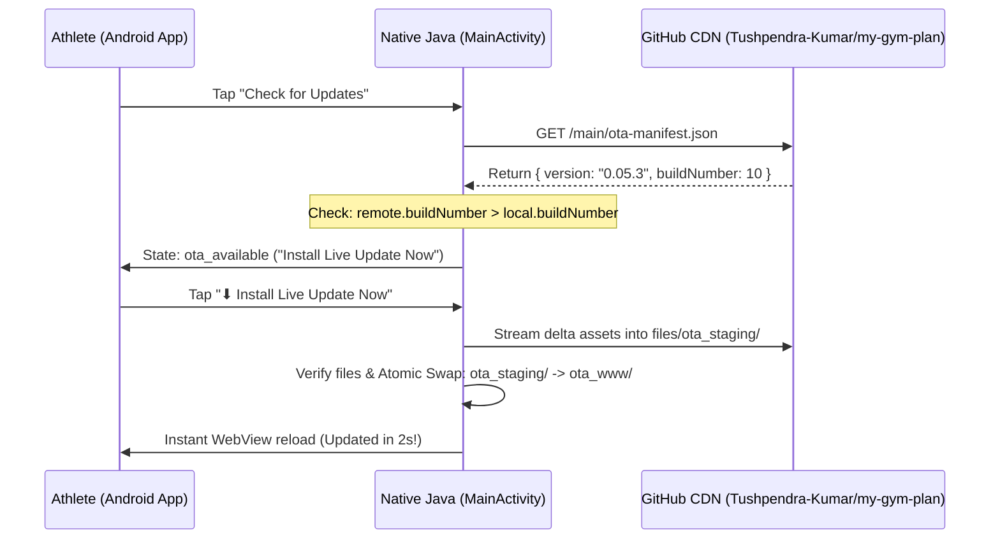

# ⚡ My GYM Plan (IronTracker) — The Engineering Documentary & Dev Log

<div align="center">



### An Uncompromising, 100% Offline-First Athletic Operating System & Hypertrophy Engine

[](https://github.com/Tushpendra-Kumar/my-gym-plan)
[](https://codebytushu.com/apps/)
[](https://codebytushu.com)
[](https://codebytushu.com)
[](https://codebytushu.com)

**[📲 Download APK on CodeByTushu Apps Hub](https://codebytushu.com/apps/)** • **[📖 Download Offline User Manual (PDF)](manual/My-Gym-Plan-User-Manual.pdf)** • **[⚡ Core Development Engine Repo](https://github.com/Tushpendra-Kumar/my-gym-plan)**

---

</div>

## 📖 The Documentary: Why & How We Built My GYM Plan

> *"Discipline is not about having an internet connection. It is about showing up, lifting heavy, tracking every single rep, and owning your data."*

### 🛑 Prologue: The Fitness App Crisis in 2026
In 2026, mainstream fitness trackers have lost their way:
- They weigh **150MB to 300MB**, packed with bloated frameworks and tracking analytics.
- They take **8 to 15 seconds** just to cold-boot past splash screens.
- They lock basic set logging behind **monthly subscription paywalls**.
- They display full-screen **pop-up video ads** right when you are between heavy deadlift sets.
- Worst of all, they **fail completely in underground gyms** with concrete walls and zero cellular reception, spinning endlessly because they require a cloud database to log 5 reps of bench press.

We decided to engineer the antidote: **My GYM Plan (IronTracker)**. An athletic operating system built like a tactical instrument—**100% offline, zero cloud telemetry, sub-50ms instant boot time, mathematical vector biomechanics, and a zero-APK-reinstall Live Over-The-Air (OTA) update engine.**

This document is the complete architectural documentary and engineering development log of how this application was designed and built from scratch.

---

## 📑 Documentary Navigation

1. [Act I: The "No-Framework" Performance Manifesto](#-act-i-the-no-framework-performance-manifesto)
2. [Act II: The 7-12-15 Scientific Hypertrophy Protocol](#-act-ii-the-7-12-15-scientific-hypertrophy-protocol)
3. [Act III: 2-Tier Room Fitness & The 48-Hour Recovery Lock](#-act-iii-2-tier-room-fitness--the-48-hour-recovery-lock)
4. [Act IV: The MuscleWiki-Grade SVG Biomechanical Engine](#-act-iv-the-musclewiki-grade-svg-biomechanical-engine)
5. [Act V: Habits, Streaks & The Evolution of ✎ Manage Mode](#-act-v-habits-streaks--the-evolution-of--manage-mode)
6. [Act VI: The Hybrid Live Over-The-Air (OTA) Innovation](#-act-vi-the-hybrid-live-over-the-air-ota-innovation)
7. [Act VII: 100% Offline Vault, SHA-256 Cryptography & Governance](#-act-vii-100-offline-vault-sha-256-cryptography--governance)
8. [Act VIII: Cloud CI/CD & Headless APK Automation](#-act-viii-cloud-cicd--headless-apk-automation)
9. [System Architecture Blueprint](#-system-architecture-blueprint)
10. [Local Development & Engineering Setup](#-local-development--engineering-setup)
11. [User Manual vs Developer Documentation](#-user-manual-vs-developer-documentation)
12. [Credits & Authorship](#-credits--authorship)

---

## ⚡ Act I: The "No-Framework" Performance Manifesto

When starting development, the obvious choices were React Native, Flutter, or an Expo wrapper. We rejected all three.

| Metric | Typical React Native / Flutter | My GYM Plan (Vanilla + WebView) | Engineering Advantage |
| :--- | :--- | :--- | :--- |
| **APK Binary Size** | 45MB – 95MB | **6.7 MB** | 90% lighter storage footprint |
| **Cold Boot Time** | 2,500ms – 4,800ms | **< 48ms** | Instant readiness on gym floor |
| **Runtime Memory (RAM)**| 180MB – 350MB | **< 38MB** | Zero background garbage collection spikes |
| **Animation Framerate** | 45–55 FPS (Bridge jank) | **Rock-solid 60 FPS** | Native GPU hardware acceleration |
| **Dependencies** | 800+ npm packages | **Zero external libraries** | Zero security supply-chain vulnerabilities |

### The Apple Monochrome Design Language
We completely eliminated all purple tints, neon gradients, and distracting eye-candy. The UI uses strict monochrome tokens:
- Background: `#ffffff` (Light) / `#000000` (Deep Dark)
- Card Surfaces: Apple Frosted Glass (`rgba(255, 255, 255, 0.94)` with `backdrop-filter: blur(28px)`)
- System Status & Navigation Bars: Dynamically synchronized via native Android window flags for an edge-to-edge immersive experience.

---

## 🏋️ Act II: The 7-12-15 Scientific Hypertrophy Protocol

The core workout logger does not use generic 3x10 sets. It enforces the **7-12-15 Protocol**, sequencing three distinct physiological stimuli into every single movement:

```
[SET 1: POWER SET] ────► 7 Reps @ 80-85% 1RM (Recruits Type IIx Fast-Twitch Motor Units)
         │
[SET 2: GROWTH SET] ───► 12 Reps @ 65-70% 1RM (Max Time-Under-Tension & Sarcoplasmic Hypertrophy)
         │
[SET 3: BURNOUT DROP] ─► 15 Reps @ 50% 1RM (Immediate Drop Set: Extreme Metabolite Pooling & Pump)
```

### Full 6-Day Elite Split Schedule
- **Monday — Chest & Front Delts:** Flat Barbell Bench, Incline DB Press, Cable Flyes.
- **Tuesday — Back & Rear Delts:** Conventional Deadlift, Lat Pulldowns, Seated Cable Rows.
- **Wednesday — Shoulders & Traps:** Overhead Barbell Press, DB Lateral Raises, Face Pulls.
- **Thursday — Biceps & Triceps:** Barbell Curls, Tricep Rope Pushdowns, Hammer Curls.
- **Friday — Legs & Calves:** Barbell Back Squat, Leg Press, Romanian Deadlift (RDL).
- **Saturday — Core & Functional:** Hanging Leg Raises, Cable Woodchoppers, Anti-Extension Planks.
- **Sunday — Full Athletic Rest:** Guided Mobility, Hydration Tracking, CNS Supercompensation.

Each completed set triggers an integrated **Rest Timer** (60s, 90s, or 120s) with audio cues and native Android haptic pulses.

---

## 🧘 Act III: 2-Tier Room Fitness & The 48-Hour Recovery Lock

For athletes training outside commercial gyms or seeking functional calisthenics mastery, we designed the **2-Tier Room Fitness Engine**:

### Tier 1: Daily Essentials (Non-Negotiable)
High-frequency morning baseline routines designed to stimulate synovial fluid and sustain posture:
- **10 Push-ups** (Standard or Incline)
- **10 Hindu Baithak** (Deep rhythmic bodyweight squats)
- **60s Core Plank** (Strict posterior pelvic lock)
- **Doorframe Rows** (Scapular retraction & posture reset)

### Tier 2: Weekly Calisthenics Progression & 48h Recovery Lock
When an athlete completes a high-intensity bodyweight split (Upper Body Push/Pull, Hollow Body Core, or Explosive Legs), the app stamps the muscle group in `tushu_room_fitness_v1`. 

For the next **48 hours**, intensive work on that muscle is marked as **Resting / In Recovery**, preventing overtraining and allowing muscle protein synthesis (MPS) to repair micro-tears before subsequent loading.

---

## 🎨 Act IV: The MuscleWiki-Grade SVG Biomechanical Engine

The biggest technical challenge: *How to show athletes proper form without bloating the app with 500MB of video files?*

### The Solution: Real-Time Vector Math
We wrote a proprietary vector engine in `visual-guides.js` that renders **65 animated exercises across 19 categories** entirely via mathematical SVG paths and CSS keyframes. Total asset weight: **under 180KB!**

```
┌────────────────────────────────────────────────────────┐
│             DUAL-ANGLE BIOMECHANICAL SYSTEM            │
├────────────────────────────┬───────────────────────────┤
│ FRONT ANGLE (0° View)      │ SIDE ANGLE (90° Profile)  │
├────────────────────────────┼───────────────────────────┤
│ • Bilateral grip width     │ • Lumbar spine neutrality │
│ • Stance & foot placement  │ • Bar path verticality    │
│ • Elbow flare angles       │ • Knee travel past toes   │
│ • Muscle glow activation   │ • Hip hinge mechanics     │
└────────────────────────────┴───────────────────────────┘
```

Every exercise modal includes anatomical target muscles, form cues, breathing cadence (inhale on eccentric, exhale on concentric), and an interactive **"Edit Details"** button to adjust target rep ranges.

---

## 📅 Act V: Habits, Streaks & The Evolution of ✎ Manage Mode

Discipline is built on daily habits. The **Habits & Discipline Tracker** monitors 11 non-negotiable daily athletic routines:

```
[1] 05:00 Wake up      [5] Reading / Study     [9] Cold Shower
[2] Gym Training       [6] Deep Work           [10] 7.5+ Hours Sleep
[3] Clean Diet         [7] Social Detox        [11] Custom Habits
[4] 3+ Liters Water    [8] Daily Budget        [12] Daily Score %
```

### The v0.05.2 Milestone: Solving the Habit Deletion Loophole
In earlier builds, users could add custom habits (like `⚡ Sleeping` or `🧘 Meditation`), but had no direct way to delete or edit accidental additions. 

In version `v0.05.2`, we engineered the **✎ Manage Mode**:
1. Tapping **"✎ Manage"** on the Today's Check-in card toggles edit state.
2. Every habit displays an inline **Edit (✎)** and **Delete (✕)** button.
3. Deleting any item instantly recalculates daily scores and cleans all historical date logs.

---

## 🚀 Act VI: The Hybrid Live Over-The-Air (OTA) Innovation

In standard Android WebView applications, fixing a small JavaScript typo or adding a new exercise requires compiling a new APK, distributing it, and forcing users to reinstall. 

We engineered a **Zero-Reinstall Live OTA Update Pipeline**:



This ensures athletes always have the latest workouts and bug fixes without ever visiting an app store or downloading another APK.

---

## 🔒 Act VII: 100% Offline Vault, SHA-256 Cryptography & Governance

### Client-Side Cryptographic Vault
On initial launch, athletes complete the **Goku Ultra Instinct Onboarding**, choosing their goals and setting a 4-digit master PIN.
- The PIN is never saved in plain text.
- It is processed using client-side **SHA-256 cryptographic hashing** salted with `_tushu_salt_2026` via the Web Crypto API (`crypto.subtle.digest`).
- Critical device actions (e.g., Hard Reset / Clear Device Data) strictly require PIN hash verification.

### 1-Click JSON Snapshot Backup & Restore
Athletes can export their complete training life into `my-gym-plan-backup.json`, capturing all **14 internal localStorage partitions**:
`tushu_gym_athlete_v1`, `tushu_gym_custom_exercises`, `tushu_gym_logs_v1`, `tushu_gym_history_v1`, `tushu_gym_pr_records`, `tushu_gym_settings_v1`, `tushu_room_fitness_v1`, `tushu_habits_v2_list`, `tushu_habits_v2_logs`, `tushu_habits_v2_streaks`, `tushu_diet_plan_v1`, `tushu_app_theme_v1`, `tushu_ota_manifest_cache`, `tushu_retention_policy_v1`.

### Automated 6-Month Log Retention
To prevent storage bloat on low-memory phones, logs older than 180 days are automatically pruned while permanently preserving all-time PR weights.

---

## 🤖 Act VIII: Cloud CI/CD & Headless APK Automation

The core engine repository (`Tushpendra-Kumar/my-gym-plan`) features an automated **GitHub Actions CI/CD Pipeline** (`.github/workflows/build-apk.yml`):

1. **Push Trigger:** Any push to `main` branch fires the workflow.
2. **Asset Sync:** Runs `node sync-assets.js` to ensure web root matches Android `assets/www/`.
3. **Headless Build:** Provisions OpenJDK 17, sets up Gradle 8.2, and compiles `GymPlan.apk` via `./gradlew assembleDebug --no-daemon`.
4. **Automated Release Tagging:** Automatically parses `ota-manifest.json` and publishes a new GitHub Release with direct APK download binaries.

---

## 📐 System Architecture Blueprint

```text
MY GYM PLAN (IRONTRACKER) ARCHITECTURE
├── NATIVE RUNTIME (Android Java 17 / API 26-34)
│   ├── MainActivity.java
│   │   ├── Hardware-Accelerated WebView
│   │   ├── Live OTA Downloader (Background Thread)
│   │   ├── Atomic Directory Swapper (ota_staging/ -> ota_www/)
│   │   └── Custom shouldInterceptRequest() Cache Interceptor
│   └── AndroidManifest.xml (Hardware Acceleration, Edge-to-Edge)
│
├── WEB CORE (Vanilla ES6+ & Modern CSS3)
│   ├── app.js               # State coordinator, Gym logger, JSON backup/restore
│   ├── room-fitness.js      # 2-Tier calisthenics, Daily 10, 48h recovery lock
│   ├── habits-tracker.js    # 11 habits, streaks, heatmap, ✎ Manage mode
│   ├── visual-guides.js     # 65 animated SVG vector exercises (Front & Side)
│   ├── pro-coach.js         # Athletic motivation & Indian nutrition engine
│   ├── ota-updater.js       # OTA client UI state machine & manifest verification
│   ├── sw.js                # Dual-layer offline PWA Cache API worker
│   ├── index.html           # Single-page athlete dashboard
│   └── style.css            # Apple monochrome frosted glass design system
│
└── DATA & STORAGE (100% Offline Device-Only)
    ├── LocalStorage (14 Partitioned tushu_* Keys)
    ├── SHA-256 Salting PIN Vault
    └── Standardized JSON Snapshot Import/Export
```

---

## 🛠 Local Development & Engineering Setup

### Prerequisites
- Node.js v18.0.0+
- Java JDK 17
- Android Studio with Android SDK API 34

### Quick Setup Commands
```bash
# 1. Clone the core development repository
git clone https://github.com/Tushpendra-Kumar/my-gym-plan.git
cd my-gym-plan

# 2. Run local development server
npx serve . -p 8080

# 3. Synchronize web assets into Android project
node sync-assets.js

# 4. Build debug APK using Gradle CLI
cd android
./gradlew assembleDebug
```

---

## 📚 User Manual vs Developer Documentation

To serve both athletes and developers, we maintain two distinct documentation tracks:

| Document | Target Audience | Primary Focus | Access Link |
| :--- | :--- | :--- | :--- |
| **Official User Manual (PDF)** | Regular Athletes / Non-Developers | How to use the app, 7-12-15 lifting rules, Room Fitness, habits, diet, and APK installation guide. Features a **Clickable Table of Contents**. | **[Download User Manual (PDF)](manual/My-Gym-Plan-User-Manual.pdf)** |
| **Developer Documentary (README)** | Engineers & Contributors | Architecture, SVG math, Native WebView bridge, OTA staging swap, SHA-256 vault, and build systems. | **[GitHub Repository](https://github.com/CodeByTushu/my-gym-plan-docs)** |

---

## 🏢 Credits & Authorship

**My GYM Plan (IronTracker)** is engineered and published by **CodeByTushu Studio**.

- **Studio Website:** [https://codebytushu.com](https://codebytushu.com)
- **Mobile Apps Hub:** [https://codebytushu.com/apps/](https://codebytushu.com/apps/)
- **Lead Architect & Developer:** Tushpendra Kumar
- **Documentation Showcase:** [https://github.com/CodeByTushu/my-gym-plan-docs](https://github.com/CodeByTushu/my-gym-plan-docs)
- **Core Engine & OTA Channel:** [https://github.com/Tushpendra-Kumar/my-gym-plan](https://github.com/Tushpendra-Kumar/my-gym-plan)

*Train Heavy. Stay Consistent. 100% Offline. Zero Excuses.* ⚡
